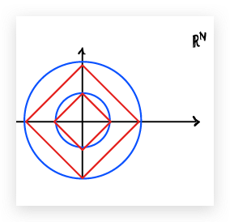
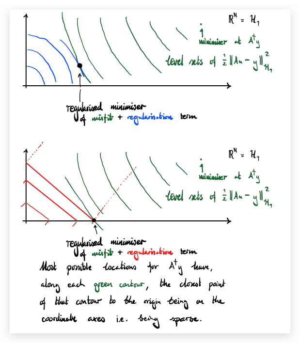

[Week 8](/notes/es98a/week8#convergence-without-a-rate-then-a-source-condition) made the compromise explicit: a small regularisation parameter reduces bias but increases noise amplification. In practice neither the truth nor the best parameter is known. How can the observations guide that compromise?

After choosing a parameter, a penalty still expresses a preference: small energy, sparse coordinates or sharp edges. We first examine those preferences, then replace a single preferred reconstruction by a posterior law. The Gaussian conditioning geometry of Week 3 returns in a function-space setting.

<h2 id="week-9">Route through this chapter</h2>

- Heuristics for choice of regularisation parameter
- $\ell^1$ regularisation as a sparsity-promoting regularisation
- Total variation regularisation for edge-preserving image reconstruction: a cautionary tale
- The Bayesian approach to inverse problems

---

<h2 id="ways-to-set-the-regularisation-parameter">Ways to set the regularisation parameter</h2>

We already discussed the situation of **a priori** regularisation: we set $\alpha$ to be a function of the noise level $\delta$ but **not** of the observed data $y$. If one also has a source condition for the signal $u$, then one can prove upper bounds for the reconstruction error, as in the extra handout from last week.

An **a posteriori** choice of $\alpha$ allows it to be a function of both $\delta$ and $y$. The danger is that we may overfit to the specific instance of $y$ that we have seen; the optimal reconstruction may do well for $y$ but poorly for other $y'$. In this situation, we typically start with a large $\alpha$ and then reduce it until the residual is approximately $\delta$. This is Morozov's discrepancy principle.

A noise-blind heuristic uses $y$ without a supplied noise bound. Bakushinskii's veto concerns **uniform deterministic convergence for arbitrary vanishing perturbations**, under the usual regularisation assumptions: a parameter rule using only noisy data cannot generally guarantee this for an unbounded inverse. It is not a prohibition on validation, probabilistic noise models or successful heuristics on restricted classes. For compact operators, closed range is equivalent to finite rank; for general bounded operators it is not.

Morozov's discrepancy principle makes the noise information explicit: for $\|y^\delta-y\|\le\delta$, seek $\|Au_\alpha-y^\delta\|\approx\tau\delta$ with $\tau>1$. Driving the residual far below the noise level asks the reconstruction to explain noise. Existence and convergence of a chosen rule need assumptions on the forward map and regularisation family. See [Clason's regularisation lecture notes](https://arxiv.org/abs/2001.00617) for the deterministic setting. Training/validation splitting instead introduces additional observations and a statistical prediction objective.

---

<h2 id="l1-regularisation-and-sparsity">L1 regularisation and sparsity</h2>

We're comparing the minimisers of

$$\frac{1}{2}\|Au-y\|^2+\frac{\alpha}{2}\|u\|^2$$

with minimisers of

$$\frac{1}{2}\|Au-y\|^2+\alpha\|u\|_1$$

Let's consider $u \in \mathbb{R}^N$ with $N$ finite, and try to understand why minimisers of the second ($\ell^1$) problem are sparse, with most $u_n=0$, whereas minimisers of the first ($\ell^2$/ridge regression/Tikhonov) problem have no special structure.

First observe that the balls of the $\ell^2$ and $\ell^1$ norms have different shapes:

This matters because minimising the regularised misfit is the same thing as finding the "closest" point of some level set of the misfit to the origin, where "closest" is measured according to the $\ell^2$ or $\ell^1$ norm as appropriate.

Corners make sparse contacts possible over whole regions of data values. This is a geometric mechanism, not a theorem that every l1 minimiser has most coordinates zero. Sparsity depends on $A$, the data and the penalty weight.

<h3 id="one-coordinate-makes-the-corner-exact">One coordinate makes the corner exact</h3>

For $A=I$, the coordinates decouple. Minimising $\tfrac12(u-y)^2+\alpha|u|$ gives the subgradient condition $0\in u-y+\alpha\partial|u|$. Thus

$$
u^*=\operatorname{sign}(y)\max\{|y|-\alpha,0\}.
$$

An interval of observations maps **exactly to zero**. In contrast ridge gives $u^*=y/(1+\alpha)$, which is nonzero whenever $y$ is. This calculation gives the source images a precise local interpretation; correlations between columns of a general $A$ couple the coordinates.

The scalar formulas let us see the difference between shrinking a coefficient and removing it.

<Figure id="es98a-threshold" caption="Exact scalar minimisers for A=I and α=1. The same axis scales show that l1 creates exact zeros on the interval [−1,1], while ridge shrinks every nonzero coefficient.">

<svg className="sci-story-svg" viewBox="0 0 340 290" role="img" aria-label="L1: a zero interval"><title>L1: a zero interval</title><path d="M45 50V195H310" fill="none" stroke="currentColor" opacity="0.5" /><text x="45" y="25">L1: a zero interval</text><text x="300" y="230" textAnchor="end">observation y</text><text x="45" y="45">estimate u</text><text x="45.00" y="210" textAnchor="middle">-3</text><text x="305.00" y="210" textAnchor="middle">3</text><text x="38" y="199.00" textAnchor="end">-3</text><text x="38" y="59.00" textAnchor="end">3</text><path d="M45.00,171.67 L46.63,170.79 L48.25,169.92 L49.87,169.04 L51.50,168.17 L53.12,167.29 L54.75,166.42 L56.38,165.54 L58.00,164.67 L59.62,163.79 L61.25,162.92 L62.88,162.04 L64.50,161.17 L66.12,160.29 L67.75,159.42 L69.38,158.54 L71.00,157.67 L72.63,156.79 L74.25,155.92 L75.88,155.04 L77.50,154.17 L79.12,153.29 L80.75,152.42 L82.38,151.54 L84.00,150.67 L85.62,149.79 L87.25,148.92 L88.88,148.04 L90.50,147.17 L92.12,146.29 L93.75,145.42 L95.38,144.54 L97.00,143.67 L98.62,142.79 L100.25,141.92 L101.88,141.04 L103.50,140.17 L105.12,139.29 L106.75,138.42 L108.38,137.54 L110.00,136.67 L111.62,135.79 L113.25,134.92 L114.88,134.04 L116.50,133.17 L118.12,132.29 L119.75,131.42 L121.38,130.54 L123.00,129.67 L124.62,128.79 L126.25,127.92 L127.88,127.04 L129.50,126.17 L131.12,125.29 L132.75,125.00 L134.38,125.00 L136.00,125.00 L137.62,125.00 L139.25,125.00 L140.88,125.00 L142.50,125.00 L144.12,125.00 L145.75,125.00 L147.38,125.00 L149.00,125.00 L150.62,125.00 L152.25,125.00 L153.88,125.00 L155.50,125.00 L157.12,125.00 L158.75,125.00 L160.38,125.00 L162.00,125.00 L163.62,125.00 L165.25,125.00 L166.88,125.00 L168.50,125.00 L170.12,125.00 L171.75,125.00 L173.38,125.00 L175.00,125.00 L176.62,125.00 L178.25,125.00 L179.88,125.00 L181.50,125.00 L183.12,125.00 L184.75,125.00 L186.38,125.00 L188.00,125.00 L189.62,125.00 L191.25,125.00 L192.88,125.00 L194.50,125.00 L196.12,125.00 L197.75,125.00 L199.38,125.00 L201.00,125.00 L202.62,125.00 L204.25,125.00 L205.88,125.00 L207.50,125.00 L209.12,125.00 L210.75,125.00 L212.38,125.00 L214.00,125.00 L215.62,125.00 L217.25,125.00 L218.88,124.71 L220.50,123.83 L222.12,122.96 L223.75,122.08 L225.38,121.21 L227.00,120.33 L228.62,119.46 L230.25,118.58 L231.88,117.71 L233.50,116.83 L235.12,115.96 L236.75,115.08 L238.38,114.21 L240.00,113.33 L241.62,112.46 L243.25,111.58 L244.88,110.71 L246.50,109.83 L248.12,108.96 L249.75,108.08 L251.38,107.21 L253.00,106.33 L254.62,105.46 L256.25,104.58 L257.88,103.71 L259.50,102.83 L261.12,101.96 L262.75,101.08 L264.38,100.21 L266.00,99.33 L267.62,98.46 L269.25,97.58 L270.88,96.71 L272.50,95.83 L274.12,94.96 L275.75,94.08 L277.38,93.21 L279.00,92.33 L280.62,91.46 L282.25,90.58 L283.88,89.71 L285.50,88.83 L287.12,87.96 L288.75,87.08 L290.38,86.21 L292.00,85.33 L293.62,84.46 L295.25,83.58 L296.88,82.71 L298.50,81.83 L300.12,80.96 L301.75,80.08 L303.38,79.21 L305.00,78.33" stroke="var(--sci-accent)" strokeWidth="2.5" fill="none" /><text x="45" y="252">solid: soft threshold, α = 1</text></svg>

<svg className="sci-story-svg" viewBox="0 0 340 290" role="img" aria-label="Ridge: uniform shrinkage"><title>Ridge: uniform shrinkage</title><path d="M45 50V195H310" fill="none" stroke="currentColor" opacity="0.5" /><text x="45" y="25">Ridge: uniform shrinkage</text><text x="300" y="230" textAnchor="end">observation y</text><text x="45" y="45">estimate u</text><text x="45.00" y="210" textAnchor="middle">-3</text><text x="305.00" y="210" textAnchor="middle">3</text><text x="38" y="199.00" textAnchor="end">-3</text><text x="38" y="59.00" textAnchor="end">3</text><path d="M45.00,160.00 L46.63,159.56 L48.25,159.12 L49.87,158.69 L51.50,158.25 L53.12,157.81 L54.75,157.38 L56.38,156.94 L58.00,156.50 L59.62,156.06 L61.25,155.62 L62.88,155.19 L64.50,154.75 L66.12,154.31 L67.75,153.88 L69.38,153.44 L71.00,153.00 L72.63,152.56 L74.25,152.12 L75.88,151.69 L77.50,151.25 L79.12,150.81 L80.75,150.38 L82.38,149.94 L84.00,149.50 L85.62,149.06 L87.25,148.62 L88.88,148.19 L90.50,147.75 L92.12,147.31 L93.75,146.88 L95.38,146.44 L97.00,146.00 L98.62,145.56 L100.25,145.12 L101.88,144.69 L103.50,144.25 L105.12,143.81 L106.75,143.38 L108.38,142.94 L110.00,142.50 L111.62,142.06 L113.25,141.62 L114.88,141.19 L116.50,140.75 L118.12,140.31 L119.75,139.88 L121.38,139.44 L123.00,139.00 L124.62,138.56 L126.25,138.12 L127.88,137.69 L129.50,137.25 L131.12,136.81 L132.75,136.38 L134.38,135.94 L136.00,135.50 L137.62,135.06 L139.25,134.62 L140.88,134.19 L142.50,133.75 L144.12,133.31 L145.75,132.88 L147.38,132.44 L149.00,132.00 L150.62,131.56 L152.25,131.12 L153.88,130.69 L155.50,130.25 L157.12,129.81 L158.75,129.38 L160.38,128.94 L162.00,128.50 L163.62,128.06 L165.25,127.62 L166.88,127.19 L168.50,126.75 L170.12,126.31 L171.75,125.88 L173.38,125.44 L175.00,125.00 L176.62,124.56 L178.25,124.12 L179.88,123.69 L181.50,123.25 L183.12,122.81 L184.75,122.38 L186.38,121.94 L188.00,121.50 L189.62,121.06 L191.25,120.62 L192.88,120.19 L194.50,119.75 L196.12,119.31 L197.75,118.88 L199.38,118.44 L201.00,118.00 L202.62,117.56 L204.25,117.12 L205.88,116.69 L207.50,116.25 L209.12,115.81 L210.75,115.38 L212.38,114.94 L214.00,114.50 L215.62,114.06 L217.25,113.62 L218.88,113.19 L220.50,112.75 L222.12,112.31 L223.75,111.88 L225.38,111.44 L227.00,111.00 L228.62,110.56 L230.25,110.12 L231.88,109.69 L233.50,109.25 L235.12,108.81 L236.75,108.38 L238.38,107.94 L240.00,107.50 L241.62,107.06 L243.25,106.62 L244.88,106.19 L246.50,105.75 L248.12,105.31 L249.75,104.88 L251.38,104.44 L253.00,104.00 L254.62,103.56 L256.25,103.12 L257.88,102.69 L259.50,102.25 L261.12,101.81 L262.75,101.38 L264.38,100.94 L266.00,100.50 L267.62,100.06 L269.25,99.62 L270.88,99.19 L272.50,98.75 L274.12,98.31 L275.75,97.88 L277.38,97.44 L279.00,97.00 L280.62,96.56 L282.25,96.12 L283.88,95.69 L285.50,95.25 L287.12,94.81 L288.75,94.38 L290.38,93.94 L292.00,93.50 L293.62,93.06 L295.25,92.62 L296.88,92.19 L298.50,91.75 L300.12,91.31 L301.75,90.88 L303.38,90.44 L305.00,90.00" stroke="var(--sci-accent)" strokeWidth="2.5" fill="none" /><text x="45" y="252">solid: y / 2, α = 1</text></svg>

</Figure>

The flat segment is the algebraic counterpart of the norm-ball corners. For a general forward matrix the coordinates interact, so this panel explains the mechanism without promising universal sparsity.

Raise the penalty for two observed coefficients. Watch when the smaller coefficient reaches zero, then compare it with ridge under the same penalty weight. The axis contact makes the corner argument precise.

<ES98AAnimation kind="soft-threshold" />

To what extent is this heuristic rigorously true when $H_1$ is genuinely infinite-dimensional? A related question is whether we can do similar tricks for edge-detection, by imposing a penalty like the $\ell^1$ norm on the derivative of $u$.

---

<h2 id="tv-regularisation-and-edge-preserving-image-reconstruction">TV regularisation and edge-preserving image reconstruction</h2>

Let's consider a 1-dimensional "image" / time series as a function $u:[a,b]\to\mathbb{R}$. If $u$ is differentiable, then we define its total variation by

$$\|u\|_{\mathrm{TV}} := \int_a^b |u'(t)| \, dt$$

**Just a seminorm** because $\|u\|_{\mathrm{TV}}=0$ for any constant $u$.

The TV seminorm is a good candidate for a regularisation that, like the $\ell^1$ norm of a vector, will sparsify $u'$, i.e. give the minimiser a few well-localised jumps/edges.

For discontinuous functions use $\mathrm{TV}(u)=|Du|([a,b])$ in the space $BV$: a jump contributes its absolute height. The differentiable formula alone would miss the very edges the penalty is meant to retain.

A separate Bayesian issue is how a discretised **prior distribution** changes as the mesh is refined. [Lassas and Siltanen (2004)](https://siltanen-research.net/wp-content/uploads/publications/LassasSiltanen2004.pdf) show loss of edge preservation for conditional means of the discretised TV priors they study. This is not a theorem that all deterministic TV minimisers, all TV-based priors or every parameter schedule fail. The source's author/year attribution and universal impossibility claim have been corrected.

This fundamental mathematical obstacle stimulated the study of (optimisation-based and Bayesian) inverse problems on function spaces directly, not just each finite-dimensional subspace individually.

---

<h2 id="the-bayesian-approach-to-inverse-problems">The Bayesian approach to inverse problems</h2>

The challenge is the same as always: we want to recover an unknown $u$ from data $y$. The Bayesian worldview is:

1. Treat the unknown and the data as random variables: $u$ (with values in $\mathcal{U}$) and $y$ (with values in $\mathcal{Y}$).

2. The beliefs you have about the unknown before seeing the data are encoded in the prior distribution $\mu_0$ of $u$ on $\mathcal{U}$.

3. The (ideal) relationship between the unknown and the data is encoded in the likelihood model.

4. The prior and the likelihood together determine the joint distribution $\mu_{(u,y)}$ of $(u,y)$ on $\mathcal{U} \times \mathcal{Y}$.

5. The Bayesian solution to the inverse problem is the conditional distribution $\mu_{u \mid y=y}$ on $\mathcal{U}$. Bayesians call this the posterior distribution.

For continuous data the event $Y=y$ usually has probability zero. Conditioning here means a regular conditional law, characterised by its reconstruction identity, rather than division by the probability of that event. The likelihood assumptions below provide an explicit version.

---

<h2 id="linear-gaussian-bayesian-inverse-problems">Linear Gaussian Bayesian inverse problems</h2>

Take $\mathcal{U}$ to be a Hilbert space $H$, let $\mathcal{Y}=\mathbb{R}^J$ for some $J \in \mathbb{N}$, and suppose that observations $y$ are made according to the linear model

$$y = Au + \eta$$

where $\eta \sim \mathcal{N}(0,\Gamma)$ in $\mathcal{Y}=\mathbb{R}^J$, with $\Gamma \in \mathbb{R}^{J \times J}$ SPD, independent of $u$.

This measurement model says that the conditional distribution of $y$ given $u$ is Gaussian with mean $Au$ and covariance $\Gamma$, i.e. it has PDF proportional to $\exp(-\Phi(u;y))$, where the potential is

$$\Phi(u;y) = \frac{1}{2} \|\Gamma^{-1/2}(Au-y)\|^2$$

Assume $A:H\to\mathbb R^J$ is bounded. Suppose that a prior $\mu_0$ for $u$ is specified; a Gaussian prior on infinite-dimensional $H$ requires SPSD trace-class $C_0$ as in Week 7. In the specific case that $\mu_0 = \mathcal{N}(m_0,C_0)$ is Gaussian, the joint distribution is again Gaussian, and the usual formula for conditioning Gaussians applies.

The posterior is $\mu_{u \mid y=y} = \mathcal{N}(m^y,C^y)$ where

$$m^y = m_0 + C_0 A^* (A C_0 A^* + \Gamma)^{-1} (y - A m_0)$$

$$C^y = C_0 - C_0 A^* (A C_0 A^* + \Gamma)^{-1} A C_0$$

(the Kalman update formula again).

Interestingly, if we compare the posterior to the prior, we notice that the posterior has a density with respect to the prior:

$$\frac{d\mu_{u \mid y=y}}{d\mu_0}(u) = \frac{\exp(-\Phi(u;y))}{Z(y)}$$

with normalising constant

$$Z(y) = \int_{\mathcal{U}} \exp(-\Phi(u;y)) \, \mu_0(du)$$

This is the more robust formulation of Bayes' rule: not "posterior = likelihood × prior" but "the density of the posterior w.r.t. the prior = the likelihood".

---

Keep the prior and noise precision fixed while moving the observed value. Follow the likelihood and the normalised posterior together. The posterior centre responds to the data while its variance is determined by the two precisions.

<ES98AAnimation kind="bayes-update" />

<h2 id="generalised-bayes-rule">Generalised Bayes rule</h2>

**Theorem** Let $\mathcal{U}=H$ be a Hilbert space and $\mathcal{Y}=\mathbb{R}^J$. Let $u \sim \mu_0$ and suppose that the conditional distribution of $y$ given $u$ has PDF $\rho_{y \mid u}$ on $\mathbb{R}^J$.

Assume a jointly measurable likelihood and a separable Hilbert parameter space. At the data values under consideration require $0<\rho_y(y)<\infty$, where

$$\rho_y(y) := \int_{\mathcal{U}} \rho_{y \mid u}(y) \, \mu_0(du)$$

Then the posterior distribution $\mu_{u \mid y=y}$ exists and has a density w.r.t. $\mu_0$ given by Bayes rule:

$$\frac{d\mu_{u \mid y=y}}{d\mu_0}(u) = \frac{\rho_{y \mid u}(y)}{\rho_y(y)}$$

**Proof.** Define the proposed conditional law $\mu^y$. For measurable parameter set $B$ and data set $D$, Tonelli gives

$$
\int_D\mu^y(B)\rho_y(y)\,dy
=\int_B\int_D\rho_{y\mid u}(y)\,dy\,\mu_0(du)
=\mathbb P(U\in B,Y\in D).
$$

This reconstruction identity proves it is a version of the conditional law. Versions agree for almost every data value; the formula specifies one wherever the denominator is positive and finite. $\square$

In the linear Gaussian model, $AC_0A^*+\Gamma$ is SPD because $\Gamma$ is, even if $C_0$ is singular. The mean update moves along directions correlated with the observations; covariance decreases without depending on the observed value. [Week 10](/notes/es98a/week10) asks how stable this entire posterior is, and how to turn it into predictions.
